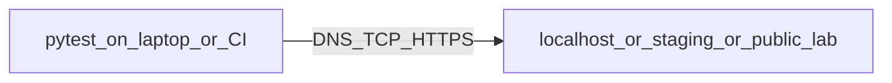

# Network test strategy

## 1. Objectives

Provide one network quality gate that can be pointed at ecommerce, ERP, a headless CMS, fintech, or a later product by changing a profile. The gate answers a single question: from this runner, can the product be resolved, connected, and read over TLS inside its time budget?

The suite is a client. It opens DNS, TCP, and HTTPS from the machine that runs pytest. It does not drive a browser, inject a process, or write to the product.

## 2. Applicability

| Reused for every product | Set per product |
|--------------------------|-----------------|
| NET-C, NET-D, NET-H, NET-P, NET-N cases | Hosts, ports, base URL, health path, expected status |
| TCP, DNS, TLS, HTTP, latency helpers | Latency SLA and timeouts |
| Smoke vs full, JUnit, HTML | Overlay endpoints (CDN, GraphQL, ERP API, gateway) |

Business rules stay in each product's own suite: checkout, ERP postings, CMS content and permissions, payment submission. This repo does not assert them.

## 3. Scope

In scope for v1:

- TCP reachability and the critical port (not ICMP)
- DNS: positive lookup, NXDOMAIN, address count, a resolver that does not answer, optional IP allowlist
- HTTPS GET, TLS version, redirect to HTTPS, required headers, a designed 4xx
- Certificate expiry window (`tls.minDaysRemaining`) and optional header-value checks (HSTS)
- Optional mTLS client handshake when `tls.mtls` cert paths are set on the runner
- Latency against the profile SLA, client timeouts, a hard retry limit
- Fail-closed TLS: expired certificate and SNI / hostname mismatch

Out of scope for v1:

- Browser, Playwright, Selenium
- Load generation
- Deep packet inspection, firewall changes, Wi-Fi radio
- Database writes, mutating API calls, payment submission

## 4. Environments

The same tests run everywhere. `NETWORK_PROFILE` and the targets file select the product. Hosts and URLs live in `config/targets.yaml` (gitignored). `.env` may set only `NETWORK_PROFILE` and optional `TARGETS_FILE`; shell and CI exports win over `.env`. The committed `config/targets.example.yaml` is a public lab (example.com and other lab hosts) so a new runner can prove the suite before any real URL is introduced.

| Environment | Runner | Targets | Suite |
|-------------|--------|---------|-------|
| DEV-LAB | Laptop | Example file, public lab | Smoke, while learning or debugging helpers |
| DEV-LOCAL | Laptop | localhost product | Smoke |
| STAGING | Laptop or CI | Staging API, CDN, GraphQL | Smoke, then full |
| CI-PR | CI agent | Staging or the public lab | Smoke only |
| CI-NIGHTLY | CI agent | Staging | Full |
| PROD-SMOKE | A controlled runner | Read-only health URLs | Smoke, and only with an explicit allow |

Access:

| Need | DEV-LAB | DEV-LOCAL | Staging / CI | PROD-SMOKE |
|------|---------|-----------|--------------|------------|
| DNS | Yes | Yes, or a hosts file | Yes | Yes |
| TCP 443 / 80 out | Yes | To localhost | Yes | Yes |
| VPN | No | Sometimes | Usual for private ERP or CMS | Per policy |
| Browser | No | No | No | No |
| Writes | No | No | No | No |

A report generated from `targets.example.yaml` is DEV-LAB evidence. `reports/evidence.txt` and the HTML environment table say so. Do not file it as a staging result.

## 5. Entry criteria

1. Python 3.11 or newer is installed. 3.12 is the CI runtime.
2. `.venv` exists and `requirements.txt` is installed.
3. `NETWORK_PROFILE` is `ecommerce`, `erp`, `cms`, or `fintech`.
4. The profile lists the hosts this run is allowed to probe. Real URLs live only in `config/targets.yaml`.
5. The runner can resolve DNS and open TCP to those hosts. Private targets: VPN is up before pytest.
6. `reports/` is writable.
7. Staging and production runs start only after smoke is green on DEV-LAB.
8. Fintech and ERP production smoke is read-only and runs from an allowlisted runner.

## 6. Exit criteria

1. Every smoke test for the selected profile passed. A smoke failure fails the job.
2. `reports/` contains the HTML report, JUnit XML when requested, and `evidence.txt` with profile, targets file, UTC timestamp, and runner hostname.
3. The targets file recorded in evidence is the one you meant (example vs real).
4. Nightly or pre-release: the full suite passed, or each failure is triaged as infra, DNS, TLS, app health, SLA, or flake.
5. No waived P0 is left without a named follow-up.

Smoke path, in order: DNS → TCP → TLS (incl. expiry window) → HTTPS GET → latency → report.

## 7. Risks and mitigations

| Risk | What you will see | Mitigation |
|------|-------------------|------------|
| ICMP blocked on the path | Ping fails while the product is up | The gate uses TCP. Do not add ping as a pass condition. |
| Flaky DNS or CDN | NET-D01 or NET-P01 fails once, then passes | NET-D01 is the only transient case, and it stops after two attempts. Other cases do not retry. |
| Several A records, one of them filtered | A closed-port check waits once per address | TCP uses one deadline for the whole attempt and prefers IPv4. |
| ERP or CMS only on the private network | DNS or TCP fails from a laptop off VPN | Entry criteria require the VPN. Triage DNS first, then TCP. |
| Fintech source allowlist | TCP timeout from CI, success from the office | Run PROD-SMOKE from the allowlisted runner. Keep tokens out of git. |
| Intercepting proxy presents its own certificate | NET-H02 or NET-N02 fails on a host you trust | Fix the runner trust store. Do not disable verification in the suite. |
| SPA returns 200 for every path | NET-H05 fails | Point `http.notFoundPath` at a real 4xx route. |
| Lab oracles change | badssl or httpbin fails while the product is fine | NET-N02, NET-N03, and NET-N04 are full-suite, not smoke. Smoke uses the product profile. |
| Example targets mistaken for staging | A green smoke that never touched the product | Evidence flags `using_example_targets=True`. |

`192.0.2.1` (TEST-NET-1) is the unreachable host and the bad resolver. It is not a product hostname.

## 8. Suites and cadence

| Suite | Marker | When | Failure means |
|-------|--------|------|----------------|
| Smoke | `-m smoke` | Every change, every PR, before staging | Stop the gate. Triage before a full run. |
| Full | default pytest | Nightly, and after smoke is green | File infra vs app vs DNS vs TLS vs flake. |

One shared suite, one profile per product. Add a product by adding a YAML block. Expand later, outside v1, with packet capture, path MTU, or multi-region runners if a real defect needs them.

## 9. Evidence

Each run writes `reports/evidence.txt`:

- profile name
- absolute targets file
- whether that file is the committed example
- UTC timestamp
- runner hostname and Python version
- process exit status and collected test count

Pass `--html` and `--junitxml` when you need to attach the run to a ticket. The HTML environment table repeats the profile and targets file.
