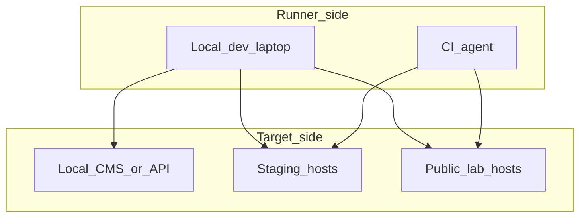
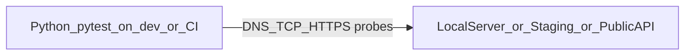
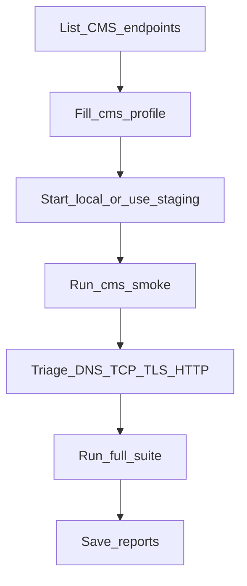
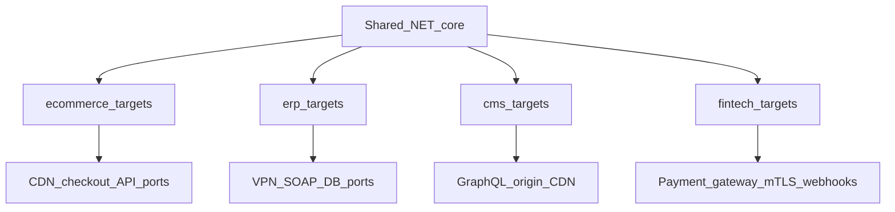
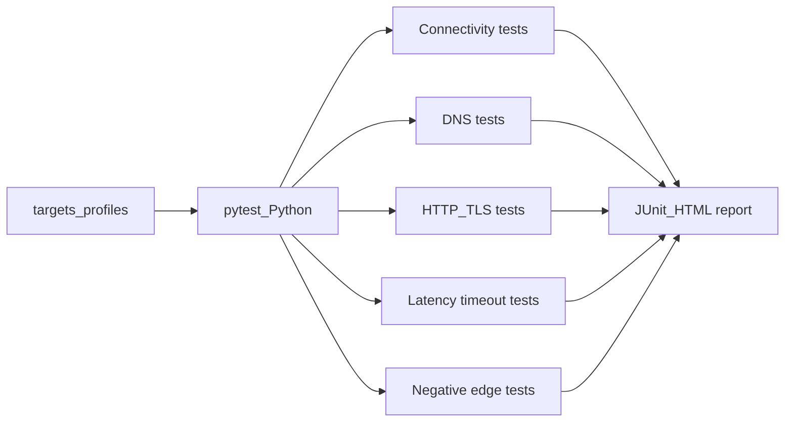

# Network Testing Plan (Senior SQA)

## Full environment plan

### 1. Purpose of environments
Define where the **test runner** lives vs which **targets** it probes. Same Python suite; different runner machines and target URLs via `NETWORK_PROFILE` + `targets.yaml`.



### 2. Runner stack (install once per machine)

| Layer | Standard |
|-------|----------|
| OS | Linux (primary), macOS, Windows + WSL2 |
| Python | **3.11+** (recommend 3.12) |
| Isolation | `python -m venv .venv` |
| Install | `pip install -r requirements.txt` |
| Test runner | pytest |
| Libraries | httpx, PyYAML, pytest-html, pytest-timeout |
| Optional lint | ruff |
| Editor | Cursor / VS Code |
| Shell env vars | `NETWORK_PROFILE`, optional `TARGETS_FILE` |
| Artifacts | `reports/` (gitignored) |
| Secrets policy | real URLs/tokens only in local `config/targets.yaml` (gitignored); commit `targets.example.yaml` only |

**Bootstrap commands:**
```bash
python3 -m venv .venv
source .venv/bin/activate          # Windows: .venv\Scripts\activate
pip install -r requirements.txt
cp config/targets.example.yaml config/targets.yaml
export NETWORK_PROFILE=cms         # or ecommerce | erp | fintech
```

### 3. Environment matrix (full)

| Env name | Runner | Typical targets | Suite | When to use |
|----------|--------|-----------------|-------|-------------|
| **DEV-LAB** | Your laptop | `example.com` / public DNS | smoke | Learn suite, debug helpers |
| **DEV-LOCAL** | Your laptop | `localhost` CMS/API | smoke | Local product running |
| **STAGING** | Laptop or CI | staging API, CDN, GraphQL | smoke + full | Pre-release network gate |
| **CI-PR** | CI agent | staging or lab | smoke only | Every PR |
| **CI-NIGHTLY** | CI agent | staging (+ overlays) | full | Nightly evidence |
| **PROD-SMOKE** | Controlled runner | prod health URLs only | smoke read-only | Optional; no writes; fintech/ERP caution |

### 4. Network access requirements per env

| Need | DEV-LAB | DEV-LOCAL | STAGING / CI | PROD-SMOKE |
|------|---------|-----------|--------------|------------|
| DNS resolve | Yes | Yes (or hosts file) | Yes | Yes |
| TCP 443/80 outbound | Yes | to localhost ports | Yes | Yes |
| VPN (ERP/private CMS) | No | Maybe | Often yes | Per policy |
| Browser | No | No | No | No |
| Write/mutate APIs | No | No | No | No |

### 5. Config model (how env is selected)

| Variable / file | Role |
|-----------------|------|
| `NETWORK_PROFILE` | `ecommerce` \| `erp` \| `cms` \| `fintech` |
| `config/targets.yaml` | Hosts, ports, baseUrl, healthPath, latencyMs, expectedStatus |
| `config/targets.example.yaml` | Safe sample committed to git |
| pytest markers | `smoke`, `connectivity`, `dns`, `http`, `perf`, `negative` |

Example profile shape (cms):
```yaml
cms:
  hosts:
    - api.cms.staging.example.com
    - cdn.cms.staging.example.com
  ports: [443]
  http:
    baseUrl: https://api.cms.staging.example.com
    healthPath: /health
    expectedStatus: [200]
  latencyMs: 800
  timeoutSec: 5
```

### 6. What is NOT part of this environment
- Browser / Playwright / Selenium
- App server process injection
- DB write tests
- Load farm (k6/Locust) — later phase if needed

### 7. CI sketch (environment in pipeline)
- Image/runtime: Python 3.12
- Steps: checkout → venv → pip install → set `NETWORK_PROFILE` → `pytest -m smoke` (PR) / full (nightly)
- Publish `reports/*.xml` and HTML as artifacts
- Fail job on P0 smoke failure

### 8. Environment readiness checklist
1. Python 3.11+ installed (`python3 --version`)
2. venv created and activated
3. deps installed from `requirements.txt`
4. `targets.yaml` present and profile filled
5. Runner can resolve DNS and open TCP to targets
6. VPN connected if target is private
7. `reports/` writable
8. Smoke passes on DEV-LAB before pointing at STAGING

## Building section — what to do (topics + environment)

### A. Development environment (set up first)

Use the **Full environment plan** above. Quick summary: Python 3.11+ / venv / pytest / httpx / PyYAML; runner on laptop or CI; targets via profile — not browser.

### B. Build topics (do in this order)

| # | Topic | What you build | Done when |
|---|-------|----------------|-----------|
| 0 | **Strategy & catalog** | `docs/network_test_strategy.md`, `docs/test_cases.md` (`NET-*` IDs) | Cases + priorities written |
| 1 | **Config & profiles** | Load YAML; select profile by env | `ecommerce`/`erp`/`cms`/`fintech` switch works |
| 2 | **Connectivity (TCP)** | `src/network_checks/tcp.py` + tests | NET-C01–C04 automated |
| 3 | **DNS** | `src/network_checks/dns.py` + tests | NET-D01–D04 automated |
| 4 | **HTTP / TLS** | `src/network_checks/http_client.py`, `tls_check.py` + tests | NET-H01–H05 automated |
| 5 | **Latency & timeouts** | `src/network_checks/latency.py` + tests | NET-P01–P03 automated |
| 6 | **Negative / edge** | Fail-closed cert, bad host, wrong port | NET-N01–N04 automated |
| 7 | **Suites & reporting** | markers `smoke`/`full`, JUnit + HTML under `reports/` | Smoke/full commands + evidence |
| 8 | **Runbook** | README: how to add a project profile + triage | Another SQA can run without you |

### C. Build order (one line)

`Env → Docs → Config → TCP → DNS → HTTP/TLS → Latency → Negative → Reports → Runbook`

### D. Where tests run vs what they hit (important)

**Environment setup above is OK** for this suite. Clarify the *side*:

| Side | Used? | Role |
|------|-------|------|
| **Python/pytest (your machine / CI)** | Yes — this is where tests execute | Client that opens DNS/TCP/HTTPS connections |
| **Local server** (app on `localhost:3000`, etc.) | Optional target | Only if profile points at it |
| **Staging / cloud APIs / CDN / gateways** | Main targets | Hosts/URLs in `targets.yaml` |
| **Browser (Chrome/Playwright)** | No — out of scope | This is not UI/E2E; no page clicks |



- **Not browser testing** — no Selenium/Playwright in v1.
- **Not inside the server process** — you probe from outside like a client.
- **Target is configurable:** local server *or* remote staging *or* payment/CDN hosts — whatever the profile lists.

**Practical default for develop:** start with public hosts (e.g. `example.com`) or your **local/staging API base URL**, not the browser.

### E. Local vs CI runner environments

| Runner environment | Purpose | Typical target |
|--------------------|---------|----------------|
| **Local develop** | Write/debug checks | Public hosts or `localhost` / staging URL |
| **Staging probes** | Product network path | Real ecommerce/ERP/CMS/fintech staging hosts |
| **CI** | PR smoke / nightly full | Same profiles; runner must reach those hosts |

### F. How to test your CMS product (steps)

This is **network probing of the CMS**, not content/editor UI testing.

**Step 1 — List CMS network endpoints**
- CMS API / GraphQL origin (e.g. `https://cms-api.staging.example.com`)
- Preview / draft site URL
- Asset / media CDN
- Webhook receiver URL (if used)
- Auth host (reachability only; no secrets in git)

**Step 2 — Fill the `cms` profile** in `config/targets.yaml`
- hosts, ports, `http.baseUrl`, health/GraphQL path
- latency SLA (e.g. 800ms staging)
- expected status (200, or 401 if auth-gated by design)

**Step 3 — Start CMS if local** (Docker/`localhost`), or use staging URLs only.

**Step 4 — Run smoke**
```bash
NETWORK_PROFILE=cms pytest -m smoke --html=reports/smoke.html --self-contained-html
```
Checks: DNS → TCP → TLS → HTTP(S) → latency.

**Step 5 — Triage failures**
- DNS → hostname/VPN/resolver
- TCP timeout → down/firewall/wrong port
- TLS → cert/SNI/CDN
- 5xx → app unhealthy
- Slow → SLA, not a content bug

**Step 6 — Run full** when smoke is green:
```bash
NETWORK_PROFILE=cms pytest --html=reports/full.html --self-contained-html --junitxml=reports/junit.xml
```

**Step 7 — Save** `reports/` as evidence (note local vs staging).

**Not covered here (separate suites):** admin UI publish flows, GraphQL business rules, permissions.



## Tech choice: Python (locked)

**Decision locked:** **Python 3.11+ + pytest** (user choice).

| Need | Python + pytest | TypeScript | Go |
|------|-----------------|------------|-----|
| TCP / DNS / TLS / HTTP | Excellent | Good | Excellent |
| SQA test culture | Strong | Good if JS team | Weaker |
| Later Scapy / SSH | Strong | Weak | Medium |
| Align with CMS JS apps | Medium | Strong | Weak |
| CI | Need Python | Need Node | Single binary |

TypeScript/Go remain alternatives only if you explicitly switch again later.

## Goal
Build a **reusable network quality gate** you can point at any product — ecommerce, ERP, headless CMS, fintech, or others — by changing config, not rewriting the suite.

**Answer to “is this for all my projects?”**
- **Yes for the shared network layer** (DNS, TCP ports, TLS, HTTP health, latency, timeouts).
- **No for business/API logic.** Checkout, payments, ERP postings, CMS content rules stay in each app’s functional suite.
- **Per project:** one `targets` profile. Optional thin network overlays (CDN, GraphQL, ERP host, payment gateway).

**Default scope (v1 shared core):**
- Layer 3/4: reachability (TCP preferred), open ports, DNS resolution
- Layer 7: HTTP(S) status, headers, TLS handshake, response time
- Non-functional: latency thresholds, timeout behavior
- Out of scope for v1: deep DPI, firewall push, load-gen at scale, Wi‑Fi RF, full functional/UI tests

## What you will deliver
1. **Test strategy** — shared core + how each product plugs in
2. **Test case catalog** — shared `NET-*` IDs + domain overlay examples
3. **Automation suite** — Python + pytest in `/home/dev2/Documents/mehedi/network_test`
4. **Runbook** — add a new project profile, run smoke/full, triage failures

## Shared core vs per-project overlay



| Layer | Reused across all projects | Configured per project |
|-------|----------------------------|-------------------------|
| Connectivity / DNS / TLS / latency | Same `NET-*` cases | Hosts, resolvers, thresholds |
| HTTP smoke | Same patterns | Base/health URLs, expected codes |
| Domain network probes | Helpers stay generic | Extra URLs/ports |
| Business assertions | Not in this suite | Own product test repos |

## Architecture



## Phase 1 — Strategy (before writing code)
Document in `docs/network_test_strategy.md`:
- Objectives, applicability, environments, entry/exit, risks (ICMP blocked → TCP fallback; flaky DNS/CDN; private ERP; fintech allowlists)

## Phase 2 — Test case & scenario catalog
Document in `docs/test_cases.md` with stable `NET-*` IDs:

### Connectivity (P0)
- NET-C01–C04: TCP reachability, critical port, unreachable host timeout, wrong port

### DNS (P0/P1)
- NET-D01–D04: resolve FQDN, NXDOMAIN, multi-A, bad resolver/timeout

### HTTP / TLS (P0)
- NET-H01–H05: health GET, TLS handshake, redirect, headers, 404/4xx

### Latency & resilience (P1)
- NET-P01–P03: SLA latency, soft timeout, limited retries

### Negative (P1/P2)
- NET-N01–N04: HTTP→HTTPS, bad cert, slow response timeout, SNI mismatch

**Smoke path:** DNS → TCP → TLS → HTTP GET → latency → report.

## Phase 3 — Automation project layout (Python)
Create under workspace root:

- `requirements.txt` — pytest, httpx, PyYAML, pytest-html, pytest-timeout
- `pytest.ini` — markers (`smoke`, `connectivity`, `dns`, `http`, `perf`, `negative`), timeout defaults
- `config/targets.example.yaml` — profiles `ecommerce`, `erp`, `cms`, `fintech`
- `src/network_checks/` — `dns.py`, `tcp.py`, `http_client.py`, `tls_check.py`, `latency.py`, `load_config.py`
- `tests/test_connectivity.py`, `tests/test_dns.py`, `tests/test_http.py`, `tests/test_latency.py`, `tests/test_negative.py`
- `README.md` — venv, profile select, smoke vs full
- `docs/network_test_strategy.md`, `docs/test_cases.md`

Map each `NET-*` ID in test names/`@pytest.mark` so failures map to the catalog.

**Implementation notes:**
- TCP: `socket.create_connection` with timeout
- DNS: `socket.getaddrinfo` / `dns.resolver` (stdlib first; dnspython optional)
- HTTP: `httpx` with timeout
- TLS: `ssl` wrap or httpx verify behavior
- Profile: `NETWORK_PROFILE` env → load matching YAML block

## Phase 4 — Execution & reporting (SQA practice)
- Suites: `smoke` (P0) vs full (P0+P1)
- Reports: JUnit XML + HTML in `reports/`
- Flake control: retries only on marked transient cases
- Evidence: profile name, timestamp, runner note

```bash
python -m venv .venv && source .venv/bin/activate
pip install -r requirements.txt
cp config/targets.example.yaml config/targets.yaml
NETWORK_PROFILE=cms pytest -m smoke --html=reports/smoke.html --self-contained-html
NETWORK_PROFILE=ecommerce pytest --junitxml=reports/junit.xml --html=reports/full.html --self-contained-html
```

## Phase 5 — Senior SQA operating cadence
- One shared suite; one profile per product
- Gate on smoke; nightly full
- Triage: infra vs app vs DNS vs TLS vs flake
- Expand later: Scapy, traceroute/MTU, multi-region probes

## Success criteria
- Same `NET-*` core for ecommerce, ERP, CMS, fintech via profiles
- Switching project = config change only
- Smoke produces HTML/JUnit evidence
- Each automated test traces to a `NET-*` case ID
